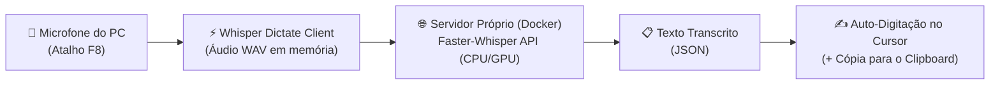

# 🎙️ Whisper Dictate PC

> **Cliente de Ditado por Voz para Windows com Atalho Global (F8) e Transcrição Privada via Faster-Whisper.**

[](https://www.python.org/)
[](https://opensource.org/licenses/MIT)
[](https://www.microsoft.com/windows)
[](https://github.com/SYSTRAN/faster-whisper)

O **Whisper Dictate PC** permite que você dite qualquer texto no Windows utilizando sua própria voz. Basta pressionar a tecla **`F8`** em qualquer lugar do sistema para que seu áudio seja gravado, transcrito em tempo real pelo seu servidor privado de IA e **digitado automaticamente** onde quer que o seu cursor esteja piscando.

Totalmente **privado**, **sem mensalidades**, com **zero latência desnecessária** e sem enviar seus dados de voz para nuvens de terceiros.

---

## 📸 Como Funciona



1. Em qualquer aplicativo (Word, WhatsApp Web, Notion, VS Code, Bloco de Notas, navegador): pressione **`F8`**.
2. Um bipe sonoro confirma o início da gravação. Fale normalmente pelo microfone.
3. Pressione **`F8`** novamente ao terminar.
4. O áudio é compactado em memória e enviado via HTTP para o seu servidor.
5. O texto transcrito é **copiado para a Área de Transferência** e **colado automaticamente** no local do cursor em poucos segundos.

---

## ✨ Principais Recursos

- ⌨️ **Atalho Global Universal (`F8`):** Funciona sem precisar rodar o terminal como Administrador (usando `pynput`).
- ✍️ **Auto-Paste Inteligente:** Simula a digitação automática (`Ctrl + V`) exatamente no campo de texto ativo.
- 📋 **Área de Transferência:** O texto transcrito também fica salvo no seu clipboard caso queira colar novamente.
- 🔔 **Feedback Sonoro Nativo:** Bipes sutis do Windows para início, parada, sucesso e avisos de erro.
- 🚀 **Sem Lixo no Disco:** O áudio é gravado diretamente em buffers de memória (RAM) e descartado após o envio.
- ⚙️ **Altamente Configurável:** Altere facilmente a URL da API, modelo, atalho de teclado e idioma através do arquivo `config.json`.
- 🔕 **Modo Invisível:** Acompanha scripts para rodar 100% em segundo plano, sem manter janelas de console abertas.

---

## 📦 Estrutura do Repositório

```text
whisper-dictate-pc/
├── config.json          # Configurações do servidor, atalho e preferências
├── main.py              # Aplicação principal (modo interativo com console)
├── main.pyw             # Executável silencioso (segundo plano no Windows)
├── run.bat              # Atalho rápido para iniciar via terminal/depuração
├── run_background.vbs   # Script VBScript para inicialização oculta no Windows
├── requirements.txt     # Dependências Python necessárias
├── .gitignore           # Filtros de arquivos temporários do Git
└── README.md            # Documentação da aplicação
```

---

## 🚀 Instalação e Uso no Windows

### 1. Pré-requisitos
- Ter o **Python 3.10 ou superior** instalado no Windows. *(Marque a opção "Add Python to PATH" durante a instalação).*
- Git instalado.

### 2. Clonar o Repositório
```powershell
git clone https://github.com/Soguiso/whisper-dictate-pc.git
cd whisper-dictate-pc
```

### 3. Instalar as Dependências
Abra o PowerShell ou Prompt de Comando na pasta do projeto e execute:
```powershell
pip install -r requirements.txt
```

---

## ⚙️ Configuração (`config.json`)

Abra o arquivo `config.json` e ajuste os parâmetros conforme a sua infraestrutura:

```json
{
  "whisper_url": "http://100.126.30.60:8005/v1/audio/transcriptions",
  "model": "Systran/faster-whisper-base",
  "language": "pt",
  "hotkey": "F8",
  "auto_paste": true,
  "copy_to_clipboard": true,
  "sound_feedback": true,
  "sample_rate": 16000,
  "channels": 1
}
```

| Parâmetro | Descrição | Padrão |
| :--- | :--- | :--- |
| `whisper_url` | Endpoint da API do Whisper (`/v1/audio/transcriptions`) via IP local ou VPN (Tailscale). | `"http://...:8005/..."` |
| `model` | Modelo carregado no servidor (`base`, `small`, etc.). | `"Systran/faster-whisper-base"` |
| `language` | Código do idioma (ex: `"pt"` para português, ou `null` para detecção automática). | `"pt"` |
| `hotkey` | Tecla de atalho global para alternar a gravação. | `"F8"` |
| `auto_paste` | Se `true`, cola o texto automaticamente onde o cursor estiver posicionado. | `true` |
| `copy_to_clipboard` | Se `true`, mantém o texto na Área de Transferência (`Ctrl + V`). | `true` |
| `sound_feedback` | Ativa bipes sonoros ao iniciar e finalizar gravações. | `true` |
| `sample_rate` | Taxa de amostragem do microfone (16 kHz é ideal para o Whisper). | `16000` |

---

## 🎮 Modos de Execução

### Opção 1: Modo Terminal (Ideal para Testes e Debug)
Dê um duplo clique no arquivo **`run.bat`** ou rode no terminal:
```powershell
python main.py
```
Você verá o status em tempo real de cada gravação, duração do áudio e tempo de resposta da API.

### Opção 2: Modo Invisível (Segundo Plano)
Dê um duplo clique em **`run_background.vbs`**.  
O programa será iniciado em segundo plano utilizando o interpretador `pythonw.exe`, sem nenhuma janela preta aberta na tela.

---

## 🔄 Inicializar Automaticamente com o Windows

Para que o ditado fique sempre pronto assim que você ligar o computador:

1. Pressione **`Win + R`**, digite `shell:startup` e pressione **Enter** *(abre a pasta de Inicialização do Windows)*.
2. Clique com o botão direito no arquivo **`run_background.vbs`** dentro da pasta do projeto e escolha **Criar Atalho**.
3. Mova esse atalho criado para dentro da pasta `shell:startup`.
4. Pronto! O programa iniciará de forma invisível e silenciosa sempre que o Windows inicializar.

---

## 🐳 Como Subir o Servidor Faster-Whisper (Docker)

Se você ainda não tem um servidor de transcrição rodando, pode subir um em segundos em qualquer máquina Linux ou servidor doméstico:

```yaml
services:
  whisper:
    image: fedirz/faster-whisper-server:latest-cpu
    container_name: whisper
    restart: unless-stopped
    ports:
      - "8005:8000"
    environment:
      - WHISPER__MODEL=Systran/faster-whisper-base
      - WHISPER__INFERENCE_DEVICE=cpu
      - WHISPER__COMPUTE_TYPE=int8
      - WHISPER__CPU_THREADS=2
      - WHISPER__TTL=300
      - ENABLE_UI=true
    volumes:
      - whisper_cache:/root/.cache/huggingface

volumes:
  whisper_cache:
```

Suba o container com:
```bash
docker compose up -d
```

---

## 📄 Licença

Este projeto está licenciado sob a licença [MIT](LICENSE) - sinta-se livre para usar, modificar e distribuir.
